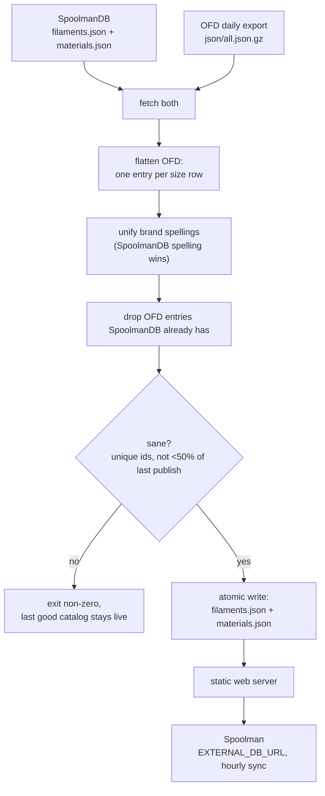

# ofd-to-spoolman

A bridge from the **[Open Filament Database](https://github.com/OpenFilamentCollective/open-filament-database) (OFD)** to **[Spoolman](https://github.com/Donkie/Spoolman)**'s external filament catalog.

Spoolman's "add filament" dropdown is populated from an external catalog, [SpoolmanDB](https://github.com/Donkie/SpoolmanDB) by default. SpoolmanDB is carefully curated but small (67 brands as of 2026-10; no Snapmaker, Inland PLA only). OFD is much larger (176 brands, ~14,600 colour variants) but uses its own schema, so Spoolman can't read it directly. OFD's maintainers confirmed this in [OFD #353](https://github.com/OpenFilamentCollective/open-filament-database/issues/353) (2026-06): *"it's not possible just like that — we use different data formats."*

`ofd2spoolman.py` merges both into one catalog in SpoolmanDB's format. You serve it from any static web server and point Spoolman at it with `EXTERNAL_DB_URL`. Spoolman itself needs no changes.

Human-directed and AI-assisted: built with Claude Code, and every change reviewed and steered by a human.

## What you get

On the first deployment (2026-10-14), the merged catalog had 29,490 filaments across 174 brands, against 8,120 / 67 for SpoolmanDB alone. Spoolman's own pydantic model (`spoolman.externaldb.ExternalFilamentsFile`) accepts it.

## How it works



A fetch or parse failure also exits non-zero without touching the published files.

### Field mapping (OFD → Spoolman `ExternalFilament`)

| Spoolman | From OFD | Notes |
|---|---|---|
| `id` | `ofd_<size.id>` | OFD's ids are stable UUIDs, so Spoolman's `external_id` links survive rebuilds |
| `manufacturer` | `brand.name` | spelling unified with SpoolmanDB where they differ only in case or punctuation |
| `name` | `filament.name` + `variant.name` | leading brand name removed; a bare material name ("PLA") removed; product lines such as `PETG+` kept |
| `material` | `filament.material` | |
| `density` | `filament.density` | required; rows without it are skipped |
| `weight` / `diameter` | `size.filament_weight` / `size.diameter` | |
| `spool_weight` | `size.empty_spool_weight` | present on ~15% of OFD sizes; null otherwise |
| `color_hex` | `variant.color_hex` | lowercased, `#` stripped, discarded if malformed |
| `extruder_temp` / `bed_temp` | midpoint of OFD min/max | a 0 bound ("unheated OK") is ignored rather than averaged in |
| `finish` | trait `matte` | Spoolman only knows matte/glossy |
| `pattern` | traits `imitates_marble` → marble, `glitter` → sparkle | |
| `translucent` / `glow` | traits `translucent`/`transparent`, `glow` | |

Discontinued products are skipped unless you pass `--include-discontinued`. Refill sizes get `(refill)` added to the name.

SpoolmanDB entries are passed through unchanged apart from brand spelling. When the same product (manufacturer, material, name, weight, diameter) is in both, the SpoolmanDB entry is kept, because SpoolmanDB has the stricter data policy: measured spool weights and no generated values.

## Usage

```
ofd2spoolman.py [--out DIR] [--dry-run] [--include-discontinued]
LOG_LEVEL=DEBUG ofd2spoolman.py --dry-run
```

It uses only the Python standard library (3.11+).

### Exit codes

| Code | Meaning | Catalog published? |
|---|---|---|
| 0 | OK | yes |
| 2 | fetch/parse failure | no |
| 3 | duplicate ids | no |
| 4 | whole catalog would shrink by more than 50% vs the live one | no |
| 5 | SpoolmanDB superset guard failed: a SpoolmanDB filament id or material is missing or changed in the output | no |
| 6 | a single source (SpoolmanDB or OFD) shrank by more than 50% vs its last good fetch | no |
| 7 | the already-published `filaments.json` exists but is unreadable, invalid JSON, not a list, or an empty list, so the shrink guard has no trustworthy baseline; a missing file is a first run and publishes. Recover by inspecting or deleting the bad file (`--dry-run` reports it too) | no |
| 10 | published, but with warnings (currently: OFD looks stalled) | yes |

Code 10 is deliberately far from the failure codes: the run succeeded, but something in the log deserves a look. Cron wrappers should treat 0 and 10 as "published". Guards 5 and 6 also run under `--dry-run`, which then returns the code without writing anything. Alerting on these codes is a separate piece of work (#13).

### Drift checks

- **Superset guard (5).** Spoolman's `EXTERNAL_DB_URL` replaces its default SpoolmanDB, so a SpoolmanDB entry we lose is gone from the dropdown. Every SpoolmanDB filament id must be in the output with identical fields (manufacturer compared after `norm()`, because brand spelling is deliberately unified across sources), and every SpoolmanDB material must be present unchanged. The comparison uses a deep copy taken before the brand rewrite.
- **Per-source shrink guard (6).** The SpoolmanDB filament count and the OFD converted-filament count are each compared with the counts recorded at the last successful publish. They may keep at least `MIN_RETAINED_FRACTION` (50%) of that: the same constant as the whole-catalog guard. Normal churn (OFD pruning discontinued items) is a few percent, a broken or empty export loses nearly everything, so anything between separates them. With no state file there is no baseline and the guard stays quiet.
- **OFD stalled (warning, exit 10).** OFD rebuilds daily. If the dataset's own `generated_at` is more than `OFD_STALE_AFTER` (3 days) old, a WARNING is logged and the run exits 10 after publishing. The warning gives the age in hours; an unparseable `generated_at` logs its own WARNING. A `generated_at` in the future never fires (clock skew is not a stall). If `generated_at` is ever absent, the fallback (needs a non-empty `version`) is how long ago this tool first saw the current `version`.
- **Input freshness (warning only, exit code unchanged).** For each fetched input (the OFD `all.json.gz`, and SpoolmanDB `filaments.json` and `materials.json`) the HTTP `Last-Modified` header and the sha256 of the fetched (gunzipped) bytes are recorded in `state.json` and compared with the previous successful run. Both moved: normal update (INFO). Neither moved: unchanged (INFO). Exactly one moved (the header changed over identical content, or the content changed under the same header): a WARNING with the stable tag `FRESHNESS-MISMATCH source=<ofd|spoolmandb_filaments|spoolmandb_materials> moved=<last_modified|sha256> ...`, also recorded under `freshness_mismatches` in `state.json`. It never blocks publishing and never changes the exit code; routing it to an alert is later work (#24). First run, no previous record, or a missing `Last-Modified` on either side (always the case with `--from-ofd-file/--from-sdb-dir`) is INFO only, because there is nothing to compare. Grep the log for `FRESHNESS-MISMATCH`.
- **SpoolmanDB content hash.** `spoolmandb_hash` / `spoolmandb_changed_at` record a canonical (key-order independent) hash of the parsed SpoolmanDB data and when this tool first saw it, for context only.
- **Resetting exit 6.** The per-source baseline only moves on a successful publish, so after a legitimate large drop exit 6 repeats on every run until you accept the new size: delete `OUT_DIR/state.json` (the next run has no baseline and publishes, then records fresh counts). A corrupt or old-schema `state.json` is handled the same way: the unusable parts are ignored with a WARNING, never a crash.

### State file

After each successful publish `OUT_DIR/state.json` is written atomically next to the catalog (and is served by the static server; it is harmless to Spoolman). Never written on `--dry-run` or a refused run, so it always describes the last good publish.

Illustrative values:

```json
{
  "run_at": "2026-10-13T04:01:57+00:00",
  "ofd_version": "2026.10.13",
  "ofd_generated_at": "2026-10-13T03:01:57Z",
  "ofd_version_changed_at": "2026-10-13T04:01:57+00:00",
  "spoolmandb_hash": "<sha256 of the raw SpoolmanDB filaments+materials>",
  "spoolmandb_changed_at": "2026-10-13T04:01:57+00:00",
  "inputs": {
    "ofd": {"last_modified": "Tue, 13 Oct 2026 03:02:10 GMT", "sha256": "<sha256 of the gunzipped all.json>"},
    "spoolmandb_filaments": {"last_modified": "Mon, 12 Oct 2026 18:20:41 GMT", "sha256": "<sha256 of the fetched bytes>"},
    "spoolmandb_materials": {"last_modified": "Mon, 12 Oct 2026 18:20:41 GMT", "sha256": "<sha256 of the fetched bytes>"}
  },
  "freshness_mismatches": [],
  "counts": {"spoolmandb_filaments": 8120, "spoolmandb_materials": 30, "ofd_filaments": 22980}
}
```

`ofd_filaments` counts the OFD rows *converted* (22,980 on the live dataset), not the entries added after deduping against SpoolmanDB; it depends on `--include-discontinued`, so switching that flag changes the baseline and can trip exit 6 (or mask a real drop) once; delete `state.json` when changing it. `*_changed_at` only moves when the version or hash changes; since this is a once-a-day one-shot, it means "first seen by this tool", not "changed upstream at". The `version` and `generated_at` fields are the ones OFD's `all.json` actually has. `inputs` is shaped to map onto the planned manifest (#24): per input `last_modified` and `sha256`. `last_modified` is `null` when the server sent none.

### Deploying alongside Spoolman (docker compose)

See [`deploy/docker-compose.example.yml`](deploy/docker-compose.example.yml). In short:

```yaml
  spoolman:
    environment:
      - EXTERNAL_DB_URL=http://catalog/
      - EXTERNAL_DB_NAME=SpoolmanDB + OFD
  catalog:
    image: nginx:alpine
    volumes:
      - /path/to/catalog:/usr/share/nginx/html:ro
```

Then run it daily, after OFD's ~03:00 UTC rebuild:

```
15 23 * * * /usr/bin/python3 -I /path/to/ofd2spoolman.py --out /path/to/catalog > /path/to/catalog-build.log 2>&1
```

`./install.sh` copies the script to the author's deploy location, and `./install.sh --check` reports drift.

## Limitations

- **Data quality is OFD's.** Unlike SpoolmanDB, OFD doesn't require measured spool weights, and some hex codes are placeholders (e.g. "Clear" as `#ffffff`). Weigh your own empty spools.
- Duplicate detection between the two sources is exact-name based after normalisation. Products named differently in the two catalogs ("PolyTerra Black" vs "PolyTerra™ Charcoal Black") will appear twice.
- Spoolman takes a single temperature; the OFD range is collapsed to its midpoint.
- Multi-colour filaments come through as their single primary `color_hex`.

See [docs/ROADMAP.md](docs/ROADMAP.md).

## License

MIT. OFD data is MIT and SpoolmanDB data is MIT; see their repositories.
