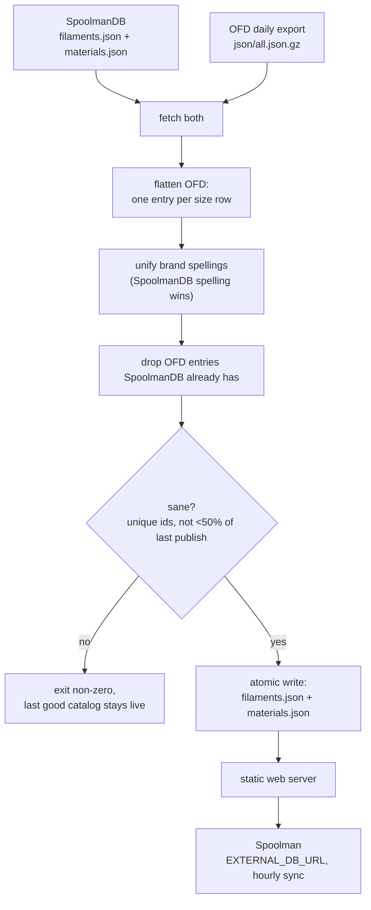
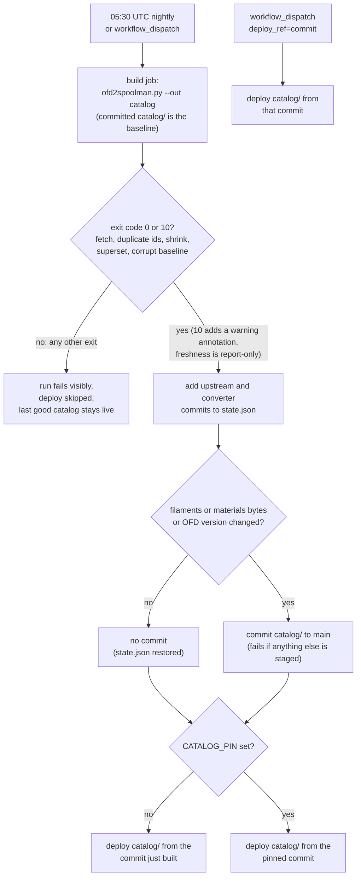

# ofd-to-spoolman

A bridge from the **[Open Filament Database](https://github.com/OpenFilamentCollective/open-filament-database) (OFD)** to **[Spoolman](https://github.com/Donkie/Spoolman)**'s external filament catalog.

Spoolman's "add filament" dropdown is populated from an external catalog, [SpoolmanDB](https://github.com/Donkie/SpoolmanDB) by default. SpoolmanDB is carefully curated but small (67 brands as of 2026-10; no Snapmaker, Inland PLA only). OFD is much larger (176 brands, ~14,600 colour variants) but uses its own schema, so Spoolman can't read it directly. OFD's maintainers confirmed this in [OFD #353](https://github.com/OpenFilamentCollective/open-filament-database/issues/353) (2026-06): *"it's not possible just like that — we use different data formats."*

`ofd2spoolman.py` merges both into one catalog in SpoolmanDB's format. You serve it from any static web server and point Spoolman at it with `EXTERNAL_DB_URL`. Spoolman itself needs no changes.

Human-directed and AI-assisted: built with Claude Code, and every change reviewed and steered by a human.

## What you get

On the first deployment (2026-10-14), the merged catalog had 29,490 filaments across 174 brands, against 8,120 / 67 for SpoolmanDB alone. Spoolman's own pydantic model (`spoolman.externaldb.ExternalFilamentsFile`) accepts it.

## How it works



A fetch or parse failure also exits non-zero without touching the published files.

Both output files are written one compact record per line (still a valid JSON array) and `filaments.json` is sorted by id, so the bytes are deterministic and diffs are readable. Spoolman parses it like any other JSON.

### Field mapping (OFD → Spoolman `ExternalFilament`)

| Spoolman | From OFD | Notes |
|---|---|---|
| `id` | `ofd_<size.uuid>` | OFD's stored canonical `uuid`, which does not change when a name, GTIN or row order is edited. The derived `size.id` is deliberately not used. Sizes without a `uuid` are skipped and counted. Spoolman has no alias concept, so a link to a `uuid` that OFD retires through `moved_from` does not follow it to the replacement |
| `manufacturer` | `brand.name` | spelling unified with SpoolmanDB where they differ only in case or punctuation |
| `name` | `filament.name` + `variant.name` | leading brand name removed; a bare material name ("PLA") removed; product lines such as `PETG+` kept |
| `material` | `filament.material` | |
| `density` | `filament.density` | required; rows without it are skipped |
| `weight` / `diameter` | `size.filament_weight` / `size.diameter` | |
| `spool_weight` | `size.empty_spool_weight` | present on ~15% of OFD sizes; null otherwise |
| `color_hex` | `variant.color_hex` | lowercased, `#` stripped, discarded if malformed |
| `extruder_temp` / `bed_temp` | midpoint of OFD min/max | a 0 bound ("unheated OK") is ignored rather than averaged in |
| `finish` | trait `matte` | Spoolman only knows matte/glossy |
| `pattern` | traits `imitates_marble` → marble, `glitter` → sparkle | |
| `translucent` / `glow` | traits `translucent`/`transparent`, `glow` | |

Discontinued products are skipped unless you pass `--include-discontinued`. Refill sizes get `(refill)` added to the name.

Spoolman rejects filament names over 64 characters (`FilamentParameters.name` `max_length=64`, ORM `String(64)`), so over-long OFD-derived names are shortened deterministically: a trailing parenthetical such as `(Black & Red & Gold)` is dropped if the remainder fits and does not collide with another record of the same manufacturer, material, weight and diameter; otherwise the middle is elided to `start… end` on word boundaries, keeping the trailing colour. If two shortened names would still collide, the cut is shifted, and as a last resort a short digest of the original is appended. Every case is logged at INFO. SpoolmanDB names are never altered; one over 64 characters is logged as a warning. A trailing `(refill)` marker is never dropped as a parenthetical.

Shortened names are recomputed every run with no persisted state, so when a collision partner appears or disappears a shortened name can change between runs. Spoolman copies the name at create time and links hang on the id, so only the dropdown labels change. A duplicated `uuid` in OFD data blocks the publish with `EXIT_DUPLICATE_IDS` (fail-safe; none exist today).

SpoolmanDB entries are passed through unchanged apart from brand spelling. When the same product (manufacturer, material, name, weight, diameter) is in both, the SpoolmanDB entry is kept, because SpoolmanDB has the stricter data policy: measured spool weights and no generated values.

## Usage

```
ofd2spoolman.py --out DIR [--dry-run] [--include-discontinued]
LOG_LEVEL=DEBUG ofd2spoolman.py --out DIR --dry-run
```

It uses only the Python standard library (3.11+).

### Exit codes

| Code | Meaning | Catalog published? |
|---|---|---|
| 0 | OK | yes |
| 2 | fetch/parse failure | no |
| 3 | duplicate ids | no |
| 4 | whole catalog would shrink by more than 50% vs the live one | no |
| 5 | SpoolmanDB superset guard failed: a SpoolmanDB filament id or material is missing or changed in the output | no |
| 6 | a single source (SpoolmanDB or OFD) shrank by more than 50% vs its last good fetch | no |
| 7 | the already-published `filaments.json` exists but is unreadable, invalid JSON, not a list, or an empty list, so the shrink guard has no trustworthy baseline; a missing file is a first run and publishes. Recover by inspecting or deleting the bad file (`--dry-run` reports it too) | no |
| 10 | published, but with warnings (currently: OFD looks stalled) | yes |

Any other, unexpected exception (for example `write_state` failing after the catalog was published) escapes as a Python traceback with exit 1: in that case the catalog is already live but `state.json` is stale, so the next run compares against an old baseline. Code 10 is deliberately far from the failure codes: the run succeeded, but something in the log deserves a look. Cron wrappers should treat 0 and 10 as "published". Guards 5 and 6 also run under `--dry-run`, which then returns the code without writing anything. Alerting on these codes is a separate piece of work (#13).

### Drift checks

- **Superset guard (5).** Spoolman's `EXTERNAL_DB_URL` replaces its default SpoolmanDB, so a SpoolmanDB entry we lose is gone from the dropdown. Every SpoolmanDB filament id must be in the output with identical fields (manufacturer compared after `norm()`, because brand spelling is deliberately unified across sources), and every SpoolmanDB material must be present unchanged. The comparison uses a deep copy taken before the brand rewrite.
- **Per-source shrink guard (6).** The SpoolmanDB filament count and the OFD converted-filament count are each compared with the counts recorded at the last successful publish. They may keep at least `MIN_RETAINED_FRACTION` (50%) of that: the same constant as the whole-catalog guard. Normal churn (OFD pruning discontinued items) is a few percent, a broken or empty export loses nearly everything, so anything between separates them. With no state file there is no baseline and the guard stays quiet.
- **OFD stalled (warning, exit 10).** OFD rebuilds daily. If the dataset's own `generated_at` is more than `OFD_STALE_AFTER` (3 days) old, a WARNING is logged and the run exits 10 after publishing. The warning gives the age in hours; an unparseable `generated_at` logs its own WARNING. A `generated_at` in the future never fires (clock skew is not a stall). If `generated_at` is ever absent, the fallback (needs a non-empty `version`) is how long ago this tool first saw the current `version`.
- **Input freshness (warning only, exit code unchanged).** For each fetched input (the OFD `all.json.gz`, and SpoolmanDB `filaments.json` and `materials.json`) the HTTP `Last-Modified` header and the sha256 of the fetched (gunzipped) bytes are recorded in `state.json` and compared with the previous successful run. Both moved: normal update (INFO). Neither moved: unchanged (INFO). Exactly one moved (the header changed over identical content, or the content changed under the same header): a WARNING with the stable tag `FRESHNESS-MISMATCH source=<ofd|spoolmandb_filaments|spoolmandb_materials> moved=<last_modified|sha256> ...`, also recorded under `freshness_mismatches` in `state.json`. The one exception is SpoolmanDB (`DEPLOY_STAMPED_SOURCES` in the code): GitHub Pages stamps every file with the deploy time, so `materials.json` gets a new `Last-Modified` over identical bytes whenever `filaments.json` changes. For those two inputs a Last-Modified-only move is INFO (`status=redeployed`); changed content under an unchanged `Last-Modified` still warns. OFD warns on both one-sided cases. It never blocks publishing and never changes the exit code; routing it to an alert is later work (#24). First run, no previous record, or a missing `Last-Modified` on either side (always the case with `--from-ofd-file/--from-sdb-dir`) is INFO only, because there is nothing to compare. Grep the log for `FRESHNESS-MISMATCH`.
- **SpoolmanDB content hash.** `spoolmandb_hash` / `spoolmandb_changed_at` record a hash of the parsed SpoolmanDB data (re-serialised with sorted keys and compact separators, so it ignores key order and whitespace) and when this tool first saw it, for context only. It is a different hash from `inputs.spoolmandb_*.sha256`, which is taken over the fetched bytes.
- **Resetting exit 6.** The per-source baseline only moves on a successful publish, so after a legitimate large drop exit 6 repeats on every run until you accept the new size: delete `OUT_DIR/state.json` (the next run has no baseline and publishes, then records fresh counts). A corrupt or old-schema `state.json` is handled the same way: the unusable parts are ignored with a WARNING, never a crash.

### State file

After each successful publish `OUT_DIR/state.json` is written atomically next to the catalog (and is served by the static server; it is harmless to Spoolman). Never written on `--dry-run` or a refused run, so it always describes the last good publish.

Illustrative values:

```json
{
  "run_at": "2026-10-13T04:01:57+00:00",
  "ofd_version": "2026.10.13",
  "ofd_generated_at": "2026-10-13T03:01:57Z",
  "ofd_version_changed_at": "2026-10-13T04:01:57+00:00",
  "spoolmandb_hash": "<sha256 of the parsed, sorted-key SpoolmanDB filaments+materials; context only>",
  "spoolmandb_changed_at": "2026-10-13T04:01:57+00:00",
  "inputs": {
    "ofd": {"last_modified": "Tue, 13 Oct 2026 03:02:10 GMT", "sha256": "<sha256 of the gunzipped all.json>"},
    "spoolmandb_filaments": {"last_modified": "Mon, 12 Oct 2026 18:20:41 GMT", "sha256": "<sha256 of the fetched bytes>"},
    "spoolmandb_materials": {"last_modified": "Mon, 12 Oct 2026 18:20:41 GMT", "sha256": "<sha256 of the fetched bytes>"}
  },
  "freshness_mismatches": [],
  "counts": {"spoolmandb_filaments": 8120, "spoolmandb_materials": 30, "ofd_filaments": 22980},
  "outputs": {
    "filaments.json": {"count": 29490, "sha256": "<sha256 of the published file>"},
    "materials.json": {"count": 97, "sha256": "<sha256 of the published file>"}
  },
  "sources": {
    "ofd": {"tag": "dataset-v2026.10.13", "commit": "<commit behind that tag, or null>"},
    "spoolmandb": {"commit": "<commit its latest github-pages deployment served, or null>"}
  },
  "converter": {"commit": "<last commit that changed ofd2spoolman.py>"}
}
```

`ofd_filaments` counts the OFD rows *converted* (22,980 on the live dataset), not the entries added after deduping against SpoolmanDB; it depends on `--include-discontinued`, so switching that flag changes the baseline and can trip exit 6 (or mask a real drop) once; delete `state.json` when changing it. `*_changed_at` only moves when the version or hash changes; since this is a once-a-day one-shot, it means "first seen by this tool", not "changed upstream at". The `version` and `generated_at` fields are the ones OFD's `all.json` actually has. `last_modified` is `null` when the server sent none. `outputs` is written by `ofd2spoolman.py` (count and sha256 of the exact bytes published). `sources` and `converter` are not: they need GitHub API lookups, so `catalog_provenance.py annotate` adds them in the hosted-catalog workflow (a standalone cron run does not have them). This one file is the hosted catalog's provenance record, there is deliberately no separate manifest to drift out of sync with it.

## Hosted catalog (GitHub Pages)

A scheduled GitHub Action ([.github/workflows/catalog.yml](.github/workflows/catalog.yml)) builds the catalog nightly and serves it from GitHub Pages. To use it, point Spoolman at it:

```
EXTERNAL_DB_URL=https://csmarshall.github.io/ofd-to-spoolman/
```

This is a convenience, not a service: availability is best-effort, there is no SLA, and the data is only as good as OFD's and SpoolmanDB's. If you need certainty, run `ofd2spoolman.py` yourself (see Usage) and serve its output.

### How the nightly works



`catalog/` on `main` holds `filaments.json` (one record per line, sorted by id, so diffs are readable), `materials.json` and `state.json`. The Action commits only when `filaments.json` or `materials.json` changed or the OFD dataset version moved; a change in provenance alone (for example SpoolmanDB's deployment commit moving on a docs-only commit) does not create a commit. What Pages serves is exactly what is committed. The bot commits to `main`, but CI ignores `catalog/**`, and the commit step fails if any path other than a visible file in `catalog/` is staged. Any exit code other than 0 or 10 from `ofd2spoolman.py` (a fetch failure, 2, as well as the guards, 3-7) fails the run, skips the deploy and leaves the previous catalog live. Exit 10 (published with warnings, e.g. OFD looks stalled) still commits and deploys, and shows up as a warning annotation on the run. A nightly with no content change still redeploys the committed catalog, which repairs a failed earlier deploy.

The schedule is 05:30 UTC because OFD's dataset releases have landed between about 01:00 and 03:03 UTC, which leaves roughly 2.5 hours of margin.

### Reading the history

`git log --oneline -- catalog/` is the index; each subject names the inputs:

```
catalog: OFD 2026.10.13 (db31453) + SpoolmanDB 8f1a99f + ofd2spoolman 3a3f2a2
```

That is the OFD dataset version (and the commit behind its `dataset-v<version>` tag), the SpoolmanDB commit its Pages build served, and the last commit that changed the converter. `git log -p -- catalog/filaments.json` shows which filaments appeared, changed or vanished and when. `catalog/state.json` (also served on Pages) is the provenance record for the commit it sits in: the `sources` and `converter` blocks carry the full commit hashes, `inputs` the Last-Modified and sha256 of each fetched file, and `outputs` the count and sha256 of each published file.

### Rolling back

1. Find the good commit: `git log --oneline -- catalog/`.
2. Pin it first: `gh variable set CATALOG_PIN --body <commit>`. From now on the nightly still builds and commits, but deploys `catalog/` from the pinned commit instead of the one it just built. Only a 7-40 digit hex hash of a commit on `main` is accepted, otherwise the deploy fails.
3. Deploy it now: `gh workflow run catalog.yml -f deploy_ref=<commit>` (Actions, "catalog", "Run workflow" from `main`). This only deploys, it does not build or commit. Setting the pin first means a nightly that starts in between already deploys the right commit. The workflow does not set the variable itself, because the built-in `GITHUB_TOKEN` cannot write repository variables and a personal access token stored as a secret is a bigger exposure than one manual command.
4. To resume: `gh variable delete CATALOG_PIN`; the next nightly (or a manual run without `deploy_ref`) deploys the newest catalog again.

Gotcha: the nightly builds against the committed `catalog/` on `main`, not against what is deployed, so while pinned the bad commit is still the guard baseline. If the bad commit INFLATED the catalog (for example a duplicated or runaway source), later correct builds will look like a more-than-50% shrink and trip the guards (exit 4 or 6) until the bad commit is `git revert`ed on `main`. A bad commit that shrank the catalog does not have this problem: the guards compare against a smaller baseline.

GitHub disables scheduled workflows on public repositories after 60 days without repository activity; the catalog commits count as activity, but hopefully check the Actions tab if the catalog ever looks stale.

## Deploying alongside Spoolman (docker compose)

See [`deploy/docker-compose.example.yml`](deploy/docker-compose.example.yml). In short:

```yaml
  spoolman:
    environment:
      - EXTERNAL_DB_URL=http://catalog/
      - EXTERNAL_DB_NAME=SpoolmanDB + OFD
  catalog:
    image: nginx:alpine
    volumes:
      - /path/to/catalog:/usr/share/nginx/html:ro
```

Then run it daily, after OFD's ~03:00 UTC rebuild:

```
15 23 * * * /usr/bin/python3 -I /path/to/ofd2spoolman.py --out /path/to/catalog > /path/to/catalog-build.log 2>&1
```

`./install.sh --target /path/to/ofd2spoolman.py` copies the script into place with a "managed, do not edit" header, and `./install.sh --check --target ...` reports drift. To avoid repeating the path, put `TARGET=/path/to/ofd2spoolman.py` in a gitignored `install.local` file next to `install.sh`. `--out` is required: there is no default output directory.

## Limitations

- **Data quality is OFD's.** Unlike SpoolmanDB, OFD doesn't require measured spool weights, and some hex codes are placeholders (e.g. "Clear" as `#ffffff`). Weigh your own empty spools.
- Duplicate detection between the two sources is exact-name based after normalisation. Products named differently in the two catalogs ("PolyTerra Black" vs "PolyTerra™ Charcoal Black") will appear twice.
- Spoolman takes a single temperature; the OFD range is collapsed to its midpoint.
- Multi-colour filaments come through as their single primary `color_hex`.

See [docs/ROADMAP.md](docs/ROADMAP.md). The reasoning behind the main design choices is recorded in [docs/adr/](docs/adr/README.md).

## License

MIT. OFD data is MIT and SpoolmanDB data is MIT; see their repositories.

## Conflict report

`.github/workflows/conflict-report.yml` runs daily (and on demand) and maintains one issue, "SpoolmanDB vs OFD conflicts", listing products present in both catalogs whose density, extruder/bed temperature, spool weight or colour hex disagree beyond a small tolerance (constants at the top of `tools/conflict_report.py`), plus `size` conflicts where the two sides list different weight/diameter for the same manufacturer + material + name. Conflicts new since the previous run are posted as a comment; the previous set is kept as the `conflict-state` workflow artifact. It only reports inside this repo and never files anything upstream. Try it locally without touching GitHub: `python3 tools/conflict_report.py --dry-run`.
