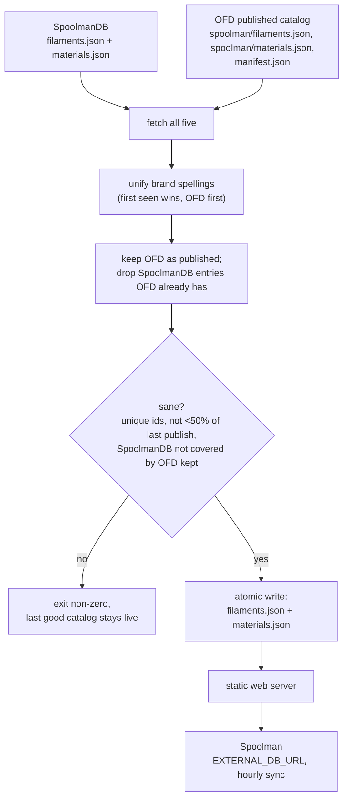
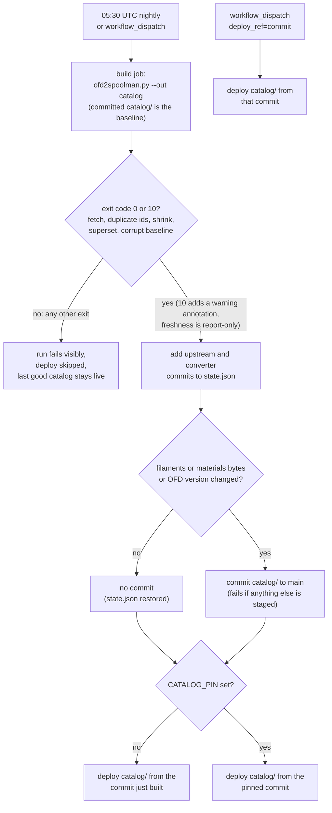

# ofd-to-spoolman

A bridge from the **[Open Filament Database](https://github.com/OpenFilamentCollective/open-filament-database) (OFD)** to **[Spoolman](https://github.com/Donkie/Spoolman)**'s external filament catalog.

Spoolman's "add filament" dropdown is populated from an external catalog, [SpoolmanDB](https://github.com/Donkie/SpoolmanDB) by default. SpoolmanDB is carefully curated but small (67 brands as of 2026-10; no Snapmaker, Inland PLA only). OFD is much larger (176 brands, ~14,600 colour variants) and its own schema is not Spoolman's, so Spoolman could not read it directly ([OFD #353](https://github.com/OpenFilamentCollective/open-filament-database/issues/353), 2026-06). Since OFD's Spoolman exporter was merged upstream (2026-11), OFD publishes a Spoolman-format catalog of its own (`spoolman/filaments.json` and `spoolman/materials.json`); Spoolman's `EXTERNAL_DB_URL` takes only one source, so this project merges that catalog with SpoolmanDB's.

`ofd2spoolman.py` merges both into one catalog in SpoolmanDB's format. Where both have the same product, **OFD's record wins** ([ADR 0009](https://github.com/csmarshall/ofd-to-spoolman/blob/main/docs/adr/0009-ofd-catalog-wins-on-overlap.md), which supersedes the earlier "SpoolmanDB wins" rule). You serve it from any static web server and point Spoolman at it with `EXTERNAL_DB_URL`. Spoolman itself needs no changes.

Human-directed and AI-assisted: built with Claude Code, and every change reviewed and steered by a human.

## What you get

On the first deployment (2026-10-14), the merged catalog had 29,490 filaments across 174 brands, against 8,120 / 67 for SpoolmanDB alone. Spoolman's own pydantic model (`spoolman.externaldb.ExternalFilamentsFile`) accepts it.

## How it works



A fetch or parse failure also exits non-zero without touching the published files.

Both output files are written one compact record per line (still a valid JSON array) and `filaments.json` is sorted by id, so the bytes are deterministic and diffs are readable. Spoolman parses it like any other JSON.

### What is merged

- **OFD filaments and materials are taken as OFD publishes them**: ids (`ofd_<size uuid>`), names, colours, temperatures and densities are OFD's exporter's output, including which products it keeps (discontinued ones are in). This project no longer has its own OFD-to-Spoolman mapping; it was retired in favour of OFD's so the two cannot drift. The one change made to an OFD record is brand spelling (below).
- **SpoolmanDB filaments are kept unless OFD has the same product**: the identity is (manufacturer, material, name, weight, diameter) after `norm()` (lowercase alphanumerics plus `+`, so `PETG+` is not `PETG`). When both have it, the OFD record is published and the SpoolmanDB one is dropped. Every other SpoolmanDB filament is passed through unchanged apart from brand spelling.
- **Materials**: OFD's `materials.json` as published, plus the SpoolmanDB materials whose name OFD's file does not list.
- **Brand spelling** is unified across the two sources (`SUNLU` vs `Sunlu`): the first spelling seen wins, and OFD is seen first.
- **Consequence for existing links:** a Spoolman filament created from a SpoolmanDB id that OFD also covers loses its catalog entry, because that id is no longer in the catalog. The filament and its spools keep working; only the link to the catalog entry dangles. Spoolman has no alias mechanism for ids.
- **A truncated OFD catalog can still publish.** With OFD now the main source, a truncated but well-formed OFD catalog that keeps at least half of the last good OFD count passes the 50% shrink guards and is published; the SpoolmanDB entries OFD had covered then reappear in the catalog.
- **Materials gap.** Filaments may reference a material that is absent from `materials.json` (on 2026-11-13: 512 filaments, all SpoolmanDB-only, for example `TPU-95A` and `PETG-CF`), because the file is OFD's materials plus only the SpoolmanDB materials OFD lacks, and SpoolmanDB's own `materials.json` does not list them either. From reading Spoolman's `externaldb.py`, it keeps `materials.json` in a cache file and treats a filament's `material` as a plain string. Whether a live Spoolman behaves well with such filaments is not verified. The run logs the names at INFO.
- Names over Spoolman's 64-character limit (`FilamentParameters.name` `max_length=64`) are **not** altered from either source; they are logged as a warning. OFD's exporter owns OFD's names.

## Usage

```
ofd2spoolman.py --out DIR [--dry-run]
LOG_LEVEL=DEBUG ofd2spoolman.py --out DIR --dry-run
```

It uses only the Python standard library (3.11+). `--include-discontinued` is still accepted but ignored (OFD's published catalog already includes discontinued products), so an existing cron line keeps working.

### Exit codes

| Code | Meaning | Catalog published? |
|---|---|---|
| 0 | OK | yes |
| 2 | fetch/parse failure | no |
| 3 | duplicate ids | no |
| 4 | whole catalog would shrink by more than 50% vs the live one | no |
| 5 | SpoolmanDB coverage guard failed: a SpoolmanDB filament OFD does not cover is missing or changed, a covered one has no OFD record with the same key in the output, or a SpoolmanDB material OFD does not list is missing or changed | no |
| 6 | a single source (SpoolmanDB or OFD) shrank by more than 50% vs its last good fetch | no |
| 7 | the already-published `filaments.json` exists but is unreadable, invalid JSON, not a list, or an empty list, so the shrink guard has no trustworthy baseline; a missing file is a first run and publishes. Recover by inspecting or deleting the bad file (`--dry-run` reports it too) | no |
| 10 | published, but with warnings (currently: OFD looks stalled) | yes |

Any other, unexpected exception (for example `write_state` failing after the catalog was published) escapes as a Python traceback with exit 1: in that case the catalog is already live but `state.json` is stale, so the next run compares against an old baseline. Code 10 is deliberately far from the failure codes: the run succeeded, but something in the log deserves a look. Cron wrappers should treat 0 and 10 as "published". Guards 5 and 6 also run under `--dry-run`, which then returns the code without writing anything. Alerting on these codes is a separate piece of work (#13).

### Drift checks

- **Coverage guard (5).** Spoolman's `EXTERNAL_DB_URL` replaces its default SpoolmanDB, so a SpoolmanDB entry we lose is gone from the dropdown, except what OFD deliberately replaces (ADR 0009). Every SpoolmanDB filament that OFD does not cover (no OFD record with the same dedupe key) must be in the output with identical fields (manufacturer compared after `norm()`, because brand spelling is deliberately unified across sources); every one OFD does cover must be accounted for by an OFD record with the same key in the output; and every SpoolmanDB material OFD's materials file does not list must be present unchanged. The comparison uses a deep copy taken before the brand rewrite. It no longer protects "nothing SpoolmanDB offered ever disappears", only "nothing OFD does not replace disappears".
- **Per-source shrink guard (6).** The SpoolmanDB filament count and the OFD published-filament count are each compared with the counts recorded at the last successful publish. They may keep at least `MIN_RETAINED_FRACTION` (50%) of that: the same constant as the whole-catalog guard. Normal churn (OFD pruning discontinued items) is a few percent, a broken or empty export loses nearly everything, so anything between separates them. With no state file there is no baseline and the guard stays quiet.
- **OFD stalled (warning, exit 10).** OFD rebuilds daily. If the manifest's own `generated_at` is more than `OFD_STALE_AFTER` (3 days) old, a WARNING is logged and the run exits 10 after publishing. The warning gives the age in hours; an unparseable `generated_at` logs its own WARNING. A `generated_at` in the future never fires (clock skew is not a stall). If `generated_at` is ever absent, the fallback (needs a non-empty `dataset_version`) is how long ago this tool first saw the current `dataset_version`.
- **Input freshness (warning only, exit code unchanged).** For each fetched input (OFD's `manifest.json`, `spoolman/filaments.json` and `spoolman/materials.json`, and SpoolmanDB's `filaments.json` and `materials.json`) the HTTP `Last-Modified` header and the sha256 of the fetched (gunzipped) bytes are recorded in `state.json` and compared with the previous successful run. Both moved: normal update (INFO). Neither moved: unchanged (INFO). Exactly one moved (the header changed over identical content, or the content changed under the same header): a WARNING with the stable tag `FRESHNESS-MISMATCH source=<ofd_manifest|ofd_filaments|ofd_materials|spoolmandb_filaments|spoolmandb_materials> moved=<last_modified|sha256> ...`, also recorded under `freshness_mismatches` in `state.json`. The exception is the inputs in `DEPLOY_STAMPED_SOURCES` in the code: SpoolmanDB (GitHub Pages stamps every file with the deploy time, so `materials.json` gets a new `Last-Modified` over identical bytes whenever `filaments.json` changes) and OFD's two catalog files (their `Last-Modified` is the build's deploy time, a second after the manifest's; that is inferred from the timestamps, not documented by OFD). For those four inputs a Last-Modified-only move is INFO (`status=redeployed`); changed content under an unchanged `Last-Modified` still warns. The OFD manifest changes on every build and warns on both one-sided cases. It never blocks publishing and never changes the exit code; routing it to an alert is later work (#24). First run, no previous record, or a missing `Last-Modified` on either side (always the case with `--from-ofd-dir/--from-sdb-dir`) is INFO only, because there is nothing to compare. Grep the log for `FRESHNESS-MISMATCH`.
- **SpoolmanDB content hash.** `spoolmandb_hash` / `spoolmandb_changed_at` record a hash of the parsed SpoolmanDB data (re-serialised with sorted keys and compact separators, so it ignores key order and whitespace) and when this tool first saw it, for context only. It is a different hash from `inputs.spoolmandb_*.sha256`, which is taken over the fetched bytes.
- **Resetting exit 6.** The per-source baseline only moves on a successful publish, so after a legitimate large drop exit 6 repeats on every run until you accept the new size: delete `OUT_DIR/state.json` (the next run has no baseline and publishes, then records fresh counts). A corrupt or old-schema `state.json` is handled the same way: the unusable parts are ignored with a WARNING, never a crash.

### State file

After each successful publish `OUT_DIR/state.json` is written atomically next to the catalog (and is served by the static server; it is harmless to Spoolman). Never written on `--dry-run` or a refused run, so it always describes the last good publish.

Illustrative values:

```json
{
  "run_at": "2026-10-13T04:01:57+00:00",
  "ofd_version": "2026.10.13",
  "ofd_generated_at": "2026-10-13T03:01:57Z",
  "ofd_version_changed_at": "2026-10-13T04:01:57+00:00",
  "spoolmandb_hash": "<sha256 of the parsed, sorted-key SpoolmanDB filaments+materials; context only>",
  "spoolmandb_changed_at": "2026-10-13T04:01:57+00:00",
  "inputs": {
    "ofd_manifest": {"last_modified": "Tue, 13 Oct 2026 03:02:10 GMT", "sha256": "<sha256 of the fetched bytes>"},
    "ofd_filaments": {"last_modified": "Tue, 13 Oct 2026 03:02:12 GMT", "sha256": "<sha256 of the fetched bytes>"},
    "ofd_materials": {"last_modified": "Tue, 13 Oct 2026 03:02:12 GMT", "sha256": "<sha256 of the fetched bytes>"},
    "spoolmandb_filaments": {"last_modified": "Mon, 12 Oct 2026 18:20:41 GMT", "sha256": "<sha256 of the fetched bytes>"},
    "spoolmandb_materials": {"last_modified": "Mon, 12 Oct 2026 18:20:41 GMT", "sha256": "<sha256 of the fetched bytes>"}
  },
  "freshness_mismatches": [],
  "counts": {"spoolmandb_filaments": 8120, "spoolmandb_materials": 30, "ofd_filaments": 24666},
  "outputs": {
    "filaments.json": {"count": 29490, "sha256": "<sha256 of the published file>"},
    "materials.json": {"count": 97, "sha256": "<sha256 of the published file>"}
  },
  "sources": {
    "ofd": {"tag": "dataset-v2026.10.13", "commit": "<commit behind that tag, or null>"},
    "spoolmandb": {"commit": "<commit its latest github-pages deployment served, or null>"}
  },
  "converter": {"commit": "<last commit that changed ofd2spoolman.py>"}
}
```

`ofd_filaments` counts the filaments in OFD's published `spoolman/filaments.json` (24,666 on 2026-11-13), not the entries added after deduping against SpoolmanDB. Before ADR 0009 it counted rows converted from `all.json` without discontinued products (22,980 on the day it was measured, 2026-10-13; not reproducible now), so the first run after the switch is expected to compare a larger number against the old baseline, which cannot trip the shrink guard. `ofd_version` and `ofd_generated_at` now come from `manifest.json` (`dataset_version`, `generated_at`); the key names and the version format are unchanged, and the `inputs.ofd` entry of an older state file is simply ignored. `*_changed_at` only moves when the version or hash changes; since this is a once-a-day one-shot, it means "first seen by this tool", not "changed upstream at". `last_modified` is `null` when the server sent none. `outputs` is written by `ofd2spoolman.py` (count and sha256 of the exact bytes published). `sources` and `converter` are not: they need GitHub API lookups, so `catalog_provenance.py annotate` adds them in the hosted-catalog workflow (a standalone cron run does not have them). This one file is the hosted catalog's provenance record, there is deliberately no separate manifest to drift out of sync with it.

## Hosted catalog (GitHub Pages)

A scheduled GitHub Action ([.github/workflows/catalog.yml](.github/workflows/catalog.yml)) builds the catalog nightly and serves it from GitHub Pages. To use it, point Spoolman at it:

```
EXTERNAL_DB_URL=https://csmarshall.github.io/ofd-to-spoolman/
```

This is a convenience, not a service: availability is best-effort, there is no SLA, and the data is only as good as OFD's and SpoolmanDB's. If you need certainty, run `ofd2spoolman.py` yourself (see Usage) and serve its output.

### How the nightly works



`catalog/` on `main` holds `filaments.json` (one record per line, sorted by id, so diffs are readable), `materials.json` and `state.json`. The Action commits only when `filaments.json` or `materials.json` changed or the OFD dataset version moved; a change in provenance alone (for example SpoolmanDB's deployment commit moving on a docs-only commit) does not create a commit. What Pages serves is exactly what is committed. The bot commits to `main`, but CI ignores `catalog/**`, and the commit step fails if any path other than a visible file in `catalog/` is staged. Any exit code other than 0 or 10 from `ofd2spoolman.py` (a fetch failure, 2, as well as the guards, 3-7) fails the run, skips the deploy and leaves the previous catalog live. Exit 10 (published with warnings, e.g. OFD looks stalled) still commits and deploys, and shows up as a warning annotation on the run. A nightly with no content change still redeploys the committed catalog, which repairs a failed earlier deploy.

The schedule is 05:30 UTC because OFD's dataset releases have landed between about 01:00 and 03:03 UTC, which leaves roughly 2.5 hours of margin.

### Reading the history

`git log --oneline -- catalog/` is the index; each subject names the inputs:

```
catalog: OFD 2026.10.13 (db31453) + SpoolmanDB 8f1a99f + ofd2spoolman 3a3f2a2
```

That is the OFD dataset version (and the commit behind its `dataset-v<version>` tag), the SpoolmanDB commit its Pages build served, and the last commit that changed the converter. `git log -p -- catalog/filaments.json` shows which filaments appeared, changed or vanished and when. `catalog/state.json` (also served on Pages) is the provenance record for the commit it sits in: the `sources` and `converter` blocks carry the full commit hashes, `inputs` the Last-Modified and sha256 of each fetched file, and `outputs` the count and sha256 of each published file.

### Rolling back

1. Find the good commit: `git log --oneline -- catalog/`.
2. Pin it first: `gh variable set CATALOG_PIN --body <commit>`. From now on the nightly still builds and commits, but deploys `catalog/` from the pinned commit instead of the one it just built. Only a 7-40 digit hex hash of a commit on `main` is accepted, otherwise the deploy fails.
3. Deploy it now: `gh workflow run catalog.yml -f deploy_ref=<commit>` (Actions, "catalog", "Run workflow" from `main`). This only deploys, it does not build or commit. Setting the pin first means a nightly that starts in between already deploys the right commit. The workflow does not set the variable itself, because the built-in `GITHUB_TOKEN` cannot write repository variables and a personal access token stored as a secret is a bigger exposure than one manual command.
4. To resume: `gh variable delete CATALOG_PIN`; the next nightly (or a manual run without `deploy_ref`) deploys the newest catalog again.

Gotcha: the nightly builds against the committed `catalog/` on `main`, not against what is deployed, so while pinned the bad commit is still the guard baseline. If the bad commit INFLATED the catalog (for example a duplicated or runaway source), later correct builds will look like a more-than-50% shrink and trip the guards (exit 4 or 6) until the bad commit is `git revert`ed on `main`. A bad commit that shrank the catalog does not have this problem: the guards compare against a smaller baseline.

GitHub disables scheduled workflows on public repositories after 60 days without repository activity; the catalog commits count as activity, but hopefully check the Actions tab if the catalog ever looks stale.

## Deploying alongside Spoolman (docker compose)

See [`deploy/docker-compose.example.yml`](deploy/docker-compose.example.yml). In short:

```yaml
  spoolman:
    environment:
      - EXTERNAL_DB_URL=http://catalog/
      - EXTERNAL_DB_NAME=SpoolmanDB + OFD
  catalog:
    image: nginx:alpine
    volumes:
      - /path/to/catalog:/usr/share/nginx/html:ro
```

Then run it daily, after OFD's ~03:00 UTC rebuild:

```
15 23 * * * /usr/bin/python3 -I /path/to/ofd2spoolman.py --out /path/to/catalog > /path/to/catalog-build.log 2>&1
```

`./install.sh --target /path/to/ofd2spoolman.py` copies the script into place with a "managed, do not edit" header, and `./install.sh --check --target ...` reports drift. To avoid repeating the path, put `TARGET=/path/to/ofd2spoolman.py` in a gitignored `install.local` file next to `install.sh`. `--out` is required: there is no default output directory.

## Limitations

- **Data quality is OFD's, and OFD wins on overlap.** Unlike SpoolmanDB, OFD doesn't require measured spool weights, and some hex codes are placeholders (e.g. "Clear" as `#ffffff`). Weigh your own empty spools. Where both catalogs have a product, SpoolmanDB's measured values are not published.
- Duplicate detection between the two sources is exact-name based after normalisation. Products named differently in the two catalogs ("PolyTerra Black" vs "PolyTerra™ Charcoal Black") will appear twice.
- Mapping decisions (temperature, names, colours, multi-colour handling, discontinued products) are OFD's exporter's, not this project's.
- The converter depends on OFD's catalog being up and well-formed; an empty or malformed file is a fetch failure (exit 2).

See [docs/ROADMAP.md](docs/ROADMAP.md).

## License

MIT. OFD data is MIT and SpoolmanDB data is MIT; see their repositories.

## Conflict report

`.github/workflows/conflict-report.yml` runs daily (and on demand) and maintains one issue, "SpoolmanDB vs OFD conflicts", listing products present in both catalogs whose density, extruder/bed temperature, spool weight or colour hex disagree beyond a small tolerance (constants at the top of `tools/conflict_report.py`), plus `size` conflicts where the two sides list different weight/diameter for the same manufacturer + material + name. Conflicts new since the previous run are posted as a comment; the previous set is kept as the `conflict-state` workflow artifact. It only reports inside this repo and never files anything upstream. Try it locally without touching GitHub: `python3 tools/conflict_report.py --dry-run`.

The conflict report still reads OFD's `json/all.json.gz` through the pre-ADR-0009 mapping, now in `tools/legacy_ofd_convert.py`, so what it compares is no longer what the catalog publishes. It needs porting to OFD's published catalog (follow-up).
