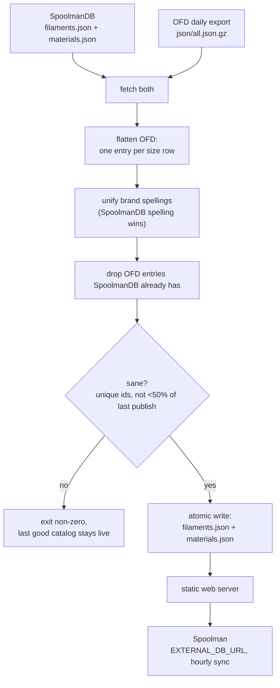

# ofd-to-spoolman

A bridge from the **[Open Filament Database](https://github.com/OpenFilamentCollective/open-filament-database) (OFD)** to **[Spoolman](https://github.com/Donkie/Spoolman)**'s external filament catalog.

Spoolman's "add filament" dropdown is populated from an external catalog, [SpoolmanDB](https://github.com/Donkie/SpoolmanDB) by default. SpoolmanDB is carefully curated but small (67 brands as of 2026-10; no Snapmaker, Inland PLA only). OFD is much larger (176 brands, ~14,600 colour variants) but uses its own schema, so Spoolman can't read it directly. OFD's maintainers confirmed this in [OFD #353](https://github.com/OpenFilamentCollective/open-filament-database/issues/353) (2026-06): *"it's not possible just like that — we use different data formats."*

`ofd2spoolman.py` merges both into one catalog in SpoolmanDB's format. You serve it from any static web server and point Spoolman at it with `EXTERNAL_DB_URL`. Spoolman itself needs no changes.

Human-directed and AI-assisted: built with Claude Code, and every change reviewed and steered by a human.

## What you get

On the first deployment (2026-10-14), the merged catalog had 29,490 filaments across 174 brands, against 8,120 / 67 for SpoolmanDB alone. Spoolman's own pydantic model (`spoolman.externaldb.ExternalFilamentsFile`) accepts it.

## How it works



A fetch or parse failure also exits non-zero without touching the published files.

### Field mapping (OFD → Spoolman `ExternalFilament`)

| Spoolman | From OFD | Notes |
|---|---|---|
| `id` | `ofd_<size.id>` | OFD's ids are stable UUIDs, so Spoolman's `external_id` links survive rebuilds |
| `manufacturer` | `brand.name` | spelling unified with SpoolmanDB where they differ only in case or punctuation |
| `name` | `filament.name` + `variant.name` | leading brand name removed; a bare material name ("PLA") removed; product lines such as `PETG+` kept |
| `material` | `filament.material` | |
| `density` | `filament.density` | required; rows without it are skipped |
| `weight` / `diameter` | `size.filament_weight` / `size.diameter` | |
| `spool_weight` | `size.empty_spool_weight` | present on ~15% of OFD sizes; null otherwise |
| `color_hex` | `variant.color_hex` | lowercased, `#` stripped, discarded if malformed |
| `extruder_temp` / `bed_temp` | midpoint of OFD min/max | a 0 bound ("unheated OK") is ignored rather than averaged in |
| `finish` | trait `matte` | Spoolman only knows matte/glossy |
| `pattern` | traits `imitates_marble` → marble, `glitter` → sparkle | |
| `translucent` / `glow` | traits `translucent`/`transparent`, `glow` | |

Discontinued products are skipped unless you pass `--include-discontinued`. Refill sizes get `(refill)` added to the name.

SpoolmanDB entries are passed through unchanged apart from brand spelling. When the same product (manufacturer, material, name, weight, diameter) is in both, the SpoolmanDB entry is kept, because SpoolmanDB has the stricter data policy: measured spool weights and no generated values.

## Usage

```
ofd2spoolman.py [--out DIR] [--dry-run] [--include-discontinued]
LOG_LEVEL=DEBUG ofd2spoolman.py --dry-run
```

It uses only the Python standard library (3.11+). Exit codes: 0 ok, 2 fetch/parse failure, 3 duplicate ids, 4 refused to shrink the catalog by more than 50%.

### Deploying alongside Spoolman (docker compose)

See [`deploy/docker-compose.example.yml`](deploy/docker-compose.example.yml). In short:

```yaml
  spoolman:
    environment:
      - EXTERNAL_DB_URL=http://catalog/
      - EXTERNAL_DB_NAME=SpoolmanDB + OFD
  catalog:
    image: nginx:alpine
    volumes:
      - /path/to/catalog:/usr/share/nginx/html:ro
```

Then run it daily, after OFD's ~03:00 UTC rebuild:

```
15 23 * * * /usr/bin/python3 -I /path/to/ofd2spoolman.py --out /path/to/catalog > /path/to/catalog-build.log 2>&1
```

`./install.sh` copies the script to the author's deploy location, and `./install.sh --check` reports drift.

## Limitations

- **Data quality is OFD's.** Unlike SpoolmanDB, OFD doesn't require measured spool weights, and some hex codes are placeholders (e.g. "Clear" as `#ffffff`). Weigh your own empty spools.
- Duplicate detection between the two sources is exact-name based after normalisation. Products named differently in the two catalogs ("PolyTerra Black" vs "PolyTerra™ Charcoal Black") will appear twice.
- Spoolman takes a single temperature; the OFD range is collapsed to its midpoint.
- Multi-colour filaments come through as their single primary `color_hex`.

See [docs/ROADMAP.md](docs/ROADMAP.md).

## License

MIT. OFD data is MIT and SpoolmanDB data is MIT; see their repositories.

## Conflict report

`.github/workflows/conflict-report.yml` runs daily (and on demand) and maintains one issue, "SpoolmanDB vs OFD conflicts", listing products present in both catalogs whose density, extruder/bed temperature, spool weight or colour hex disagree beyond a small tolerance (constants at the top of `tools/conflict_report.py`), plus `size` conflicts where the two sides list different weight/diameter for the same manufacturer + material + name. Conflicts new since the previous run are posted as a comment; the previous set is kept as the `conflict-state` workflow artifact. It only reports inside this repo and never files anything upstream. Try it locally without touching GitHub: `python3 tools/conflict_report.py --dry-run`.
